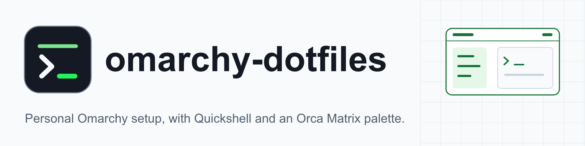
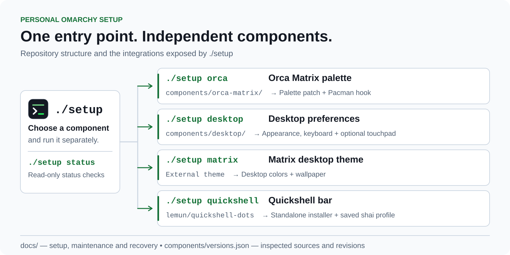

<div align="center">

<picture>
  <source media="(prefers-color-scheme: dark)" srcset="docs/assets/banner-dark.png">
  <source media="(prefers-color-scheme: light)" srcset="docs/assets/banner-light.png">
  
</picture>

### A personal Omarchy setup you can install one component at a time.

[What's inside](#whats-inside) · [Install](#install) · [Structure](#structure) · [Customizing](#customizing) · [Maintenance](#maintenance-and-recovery) · [Credits](#credits)

</div>

This repo is the entry point for my [Omarchy](https://omarchy.org) customizations.
Components can be installed independently. It does not snapshot your home directory.

<!-- TODO(owner): add 1-2 real desktop screenshots (e.g. docs/assets/desktop.png) in a "Screenshots" section here. -->

> [!WARNING]
> This targets an installed **Omarchy (Arch Linux / Hyprland)** system. It will not
> work on macOS or other distributions. Every component that changes your live
> session asks for explicit approval first.

## What's inside

| Component | What it does | Command |
|---|---|---|
| Orca Matrix palette | Root-owned patch that applies the Matrix palette to the Orca AUR app, plus a Pacman hook that reapplies it after `orca-ide-bin` installs or upgrades | `./setup orca` |
| Matrix theme | Installs and selects the [Matrix](https://github.com/BVisagie/omarchy-matrix-theme) Omarchy theme | `./setup matrix` |
| Quickshell bar | Hands off to the standalone [lemun/quickshell-dots](https://github.com/lemun/quickshell-dots) installer (saved `shai` profile, AirPods controls) | `./setup quickshell` |
| Desktop preferences | Optional Hyprland Lua module: US/Hebrew layouts, Caps Lock as Compose, no mouse-driven focus, gaps, borders, rounding, inactive dimming, no blur/glow | `./setup desktop` |
| MacBook touchpad | Optional palm protection (`macbook-touchpad.lua`); not applied by `./setup desktop`, see [docs/desktop.md](docs/desktop.md) | manual |
| Status | Read-only report of installed versions and Orca patch compatibility | `./setup status` |

Quickshell stays in [lemun/quickshell-dots](https://github.com/lemun/quickshell-dots),
with its own installer, saved `shai` profile, updates and
[copy-and-paste guide](https://github.com/lemun/quickshell-dots/blob/main/docs/airpods.md).
Nothing from that project is vendored here. Orca remains the installed AUR binary;
there is no Orca source fork.

## Install

Use an installed Omarchy system and a normal user with sudo access. The desktop
component requires Omarchy 4's Lua Hyprland configuration. The inspected system
was Omarchy 4.0.4-1 with orca-ide-bin 1.4.217-1. Future Orca palettes must pass the
compatibility check. Python uses only the standard library.

Clone this repository, then open a terminal in its directory:

```bash
mkdir -p ~/Work
git clone https://github.com/lemun/omarchy-dotfiles.git ~/Work/omarchy-dotfiles
cd ~/Work/omarchy-dotfiles
```

For an existing clean checkout, use `git pull --ff-only origin main` instead.

Install missing prerequisites; package installation needs sudo:

```bash
sudo pacman -S --needed git python
# For Quickshell (usually already available on Omarchy):
sudo pacman -S --needed quickshell jq curl pacman-contrib coreutils util-linux procps-ng \
  ttf-jetbrains-mono-nerd ttf-material-symbols-variable
# Orca is an optional AUR application:
yay -S --needed orca-ide-bin
```

Then install the components you want:

```bash
cd ~/Work/omarchy-dotfiles
./setup --help
./setup status
./setup orca
./setup matrix
./setup quickshell
# Optional saved keyboard/focus/appearance preferences:
./setup desktop
```

`orca` installs the script and hook using sudo and applies the palette if Orca
is installed. You can install the hook first and install Orca later. It does not
launch or close Orca. An open Orca window sees the colors on your next normal launch.
An existing archive made by the old script needs the one-time recovery in
[docs/orca.md](docs/orca.md) first.

`matrix`, `quickshell`, and `desktop` announce their effects and ask for explicit
approval. Run them yourself when ready. Theme selection changes colors and
wallpaper and runs theme hooks; Quickshell starts/replaces the bar and installs
its startup integration. The desktop command changes live Hyprland settings.

By default the Quickshell wrapper uses sibling `~/Work/quickshell-dots`; override
with `QUICKSHELL_DOTS_DIR=/your/checkout ./setup quickshell`. Existing checkouts
are not pulled or merged automatically. The fork's installer fetches its `main`
branch itself. Upstream theme/plugin and Quickshell updates are intentionally
moving components; `components/versions.json` records inspected revisions rather
than promising every external dependency is locked. Use each project's update
instructions and record new validated revisions here.

## Structure

<p align="center">
  <picture>
    <source media="(prefers-color-scheme: dark)" srcset="docs/assets/how-it-works-dark.svg">
    
  </picture>
</p>

```text
setup                         component commands and read only status
components/versions.json      source URLs and inspected revisions
components/orca-matrix/       Orca palette overlay, installer, Pacman hook
components/desktop/           optional appearance, keyboard and touchpad preferences
docs/                         setup, recovery and machine-specific notes
```

## Customizing

- **Desktop preferences:** edit `components/desktop/personal.lua` (layouts, gaps,
  borders, rounding, dimming) or `components/desktop/macbook-touchpad.lua`, then
  rerun `./setup desktop`. Each run backs up what it touches; see
  [docs/desktop.md](docs/desktop.md).
- **Orca palette:** rerun `./setup orca` after editing the patch to refresh the
  root-owned copy.
- **Quickshell:** override the checkout with
  `QUICKSHELL_DOTS_DIR=/your/checkout ./setup quickshell`, and save later bar
  preferences with `~/Work/quickshell-dots/scripts/qs-save-profile`.
- **New components:** add them by hand with explicit paths, backups and recovery
  commands.

## AirPods and account widgets

Follow the fork's [AirPods guide](https://github.com/lemun/quickshell-dots/blob/main/docs/airpods.md)
for plugin and daemon installation. Those commands can install packages and
start services; inspect their effects before running them on an active session.
Pair AirPods locally. Bluetooth pairing keys are never copied.

The Quickshell command passes `--no-ai-backend`; sign into accounts on each
machine and opt into usage backends using the fork's documented setup. Save
later bar preferences with `~/Work/quickshell-dots/scripts/qs-save-profile`.
That command commits and pushes in the standalone fork. This repo doesn't run it.

## Maintenance and recovery

- [Keeping the setup repo and Quickshell fork updated](docs/maintenance.md)
- [Orca safety, verification, upgrades, restore and legacy recovery](docs/orca.md)
- [Desktop preferences, backup and restore](docs/desktop.md)
- [Inspected configuration and hardware specific components](docs/machine-notes.md)
- [Display switching and lock-screen crash mitigation](docs/display-lock-crashes.md)

Rerun `./setup orca` after editing the patch to refresh the root-owned copy. The
Pacman hook automatically reapplies after installing/upgrading `orca-ide-bin`.
Hook failures are reported by Pacman after the package transaction; inspect the
error and follow the Orca guide. They cannot undo the completed upgrade.

Add future components by hand with explicit paths, backups and recovery commands.
Never commit `.config/orca`, `.ssh`, `.aws`, `.claude`, `.codex`, cookies, tokens,
Bluetooth keys, cache/state directories, generated current themes, machine IDs,
monitor layouts or suspend/power policies. A `.gitignore` is only a guardrail;
review `git diff --cached` before publishing.

## Credits

- [Omarchy](https://omarchy.org) by DHH and contributors, the Arch Linux / Hyprland base this builds on.
- [BVisagie/omarchy-matrix-theme](https://github.com/BVisagie/omarchy-matrix-theme), the Matrix desktop theme.
- [thisisgm/omarchy-pods](https://github.com/thisisgm/omarchy-pods), the optional AirPods plugin.
- [Orca](https://aur.archlinux.org/packages/orca-ide-bin), the application whose palette is overlaid.
